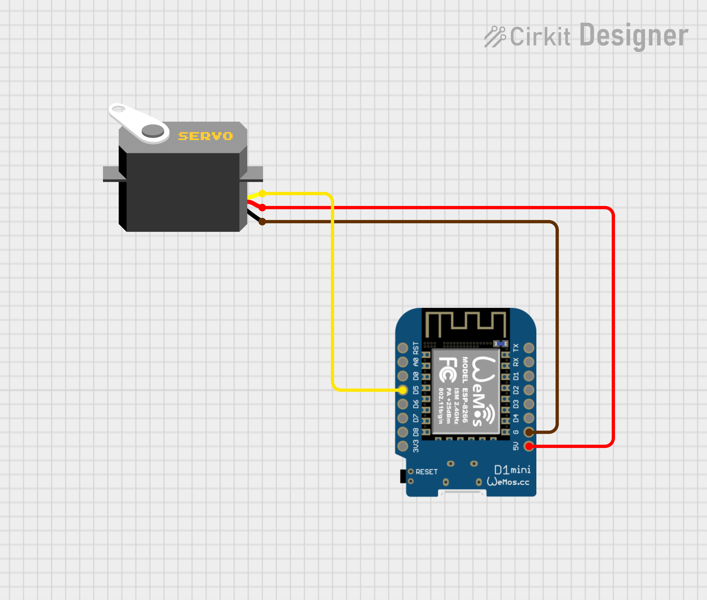

# 🐟 Smart Automatic Fish Feeders

An automatic fish-feeding system built with an **ESP8266 D1 mini** and a **servo motor**. The project supports manual feeding through HTTP endpoints and up to five scheduled feeding slots.

## ✨ Features

- **Manual feeding** through the HTTP `/feed` endpoint.
- **Feeding schedules** with up to 5 time slots.
- **Schedule storage** using EEPROM, so schedules remain saved after the device restarts.
- **Time synchronization** through the `/syncTime` endpoint.
- **Servo movement duration adjustment** through the `/setSpeed` endpoint.
- **Wi-Fi Access Point**: the ESP8266 creates its own hotspot so another device can connect directly.

## 🧰 Components

| Component | Purpose |
|---|---|
| ESP8266 D1 mini | Microcontroller and Wi-Fi Access Point |
| Servo motor (e.g. SG90) | Moves the mechanism that dispenses fish food |
| Jumper wires | Connect the servo to the board |
| Suitable 5V power supply | Powers the circuit |

## 🔌 Wiring Diagram

The following diagram shows how to connect the servo motor to the ESP8266 D1 mini.



### Pin connections

| Servo wire | ESP8266 D1 mini | Description |
|---|---|---|
| Yellow | D5 | Servo control signal |
| Red | 5V | Positive power supply |
| Brown | G (GND) | Ground |

> **Power note:** Make sure the voltage and current meet the servo's specifications. If the servo causes the board to restart or the Wi-Fi connection to drop, use a suitable external 5V power supply for the servo and connect the power supply GND to the ESP8266 GND. Do not power the servo from the 3.3V pin.

## 💻 Software and Libraries

- Arduino IDE
- ESP8266 board package for Arduino IDE
- `ESP8266WiFi` library
- `ESP8266WebServer` library
- `Servo` library
- `EEPROM` library

The `ESP8266WiFi`, `ESP8266WebServer`, and `EEPROM` libraries are included with the ESP8266 board package. Make sure the `Servo` library is also available in the Arduino IDE.

## 🚀 Installation

1. Install the Arduino IDE.
2. Install the **ESP8266** board package through the Boards Manager.
3. Connect the ESP8266 D1 mini to your computer.
4. Open `SmartAutomaticFishFeeder.ino`.
5. Select the appropriate ESP8266 D1 mini board and the connected port.
6. Check the Wi-Fi configuration in the `HOTSPOT` section of the sketch.
7. Upload the program to the board.
8. Open the Serial Monitor at **115200 baud** to view the Access Point status and device IP address.

## 📡 How It Works

1. The ESP8266 starts an Access Point and an HTTP web server on port 80.
2. Another device connects to the ESP8266 hotspot.
3. The device time is synchronized through the `/syncTime` endpoint.
4. The user can trigger manual feeding through `/feed` or configure a schedule through `/setTime`.
5. When the current time matches an active schedule, the servo moves to 90° for the configured duration and then returns to 0°.
6. A schedule that has been executed is disabled to prevent it from running repeatedly during the same minute.

## 🌐 HTTP API Endpoints

The default ESP8266 Access Point IP address is `192.168.4.1` under the standard Access Point configuration. Use the IP address shown in the Serial Monitor if it is different.

| Endpoint | Parameters | Description |
|---|---|---|
| `/feed` | None | Runs the servo to dispense food manually |
| `/setTime` | `slot`, `hour`, `minute` | Sets a schedule for a specific slot (slot 0–4) |
| `/clearTime` | `slot` | Disables and clears a schedule slot |
| `/syncTime` | `hour`, `minute` | Sets the device's initial time |
| `/setSpeed` | `durasi` | Sets the servo movement duration in milliseconds |

Example requests:

```text
http://192.168.4.1/feed

http://192.168.4.1/setTime?slot=0&hour=7&minute=30

http://192.168.4.1/clearTime?slot=0

http://192.168.4.1/syncTime?hour=7&minute=0

http://192.168.4.1/setSpeed?durasi=500
```

These examples show the request formats handled by the sketch. Schedule slot indexes range from `0` to `4`.

## ⚙️ Configuration

The main settings are located in `SmartAutomaticFishFeeder.ino`:

| Variable | Description |
|---|---|
| `MAX_SCHEDULE` | Number of schedule slots (default: 5) |
| `servoDuration` | Servo movement duration in milliseconds (default: 500 ms) |
| `ssid` | ESP8266 Access Point name |
| `password` | ESP8266 Access Point password |

**Security:** Change the default Access Point name and password before using the device. Do not commit personal passwords or credentials reused elsewhere to a public repository.

## ⚠️ Implementation Notes

- The program uses a `millis()`-based timer rather than an RTC module. Therefore, the time must be synchronized through `/syncTime` after the device starts.
- The device keeps time using its internal counter. Timekeeping may be affected if the board restarts or loses power.
- A schedule is disabled after it runs. Configure it again if you want to use it again.
- The endpoints in the sketch return simple text responses. This README documents the API implemented in the code, not a separate web application.

## 📁 Repository Structure

```text
SmartAutomaticFishFeeder/
├── assets/
│   └── circuit-diagram.png
├── SmartAutomaticFishFeeder.ino
└── README.md
```

## 🔭 Future Improvements

- Add an RTC module to maintain accurate time after a restart.
- Build a web interface for schedule configuration and manual feeding.
- Add status indicators and notifications.
- Add a sensor to monitor the remaining fish food.

## 👨‍💻 Author

**Beryl Dumanao**

GitHub: [@beryldumanao](https://github.com/beryldumanao)

---

If you find this project useful, consider giving the repository a ⭐.
